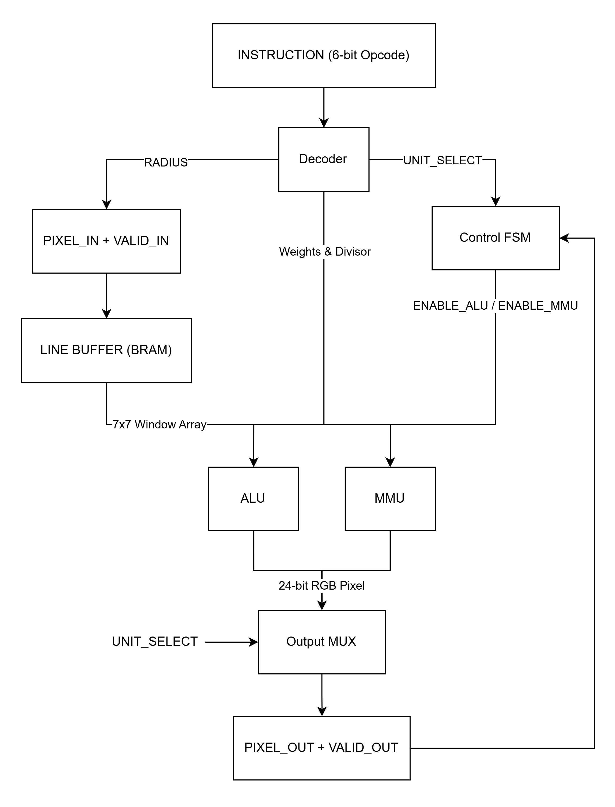
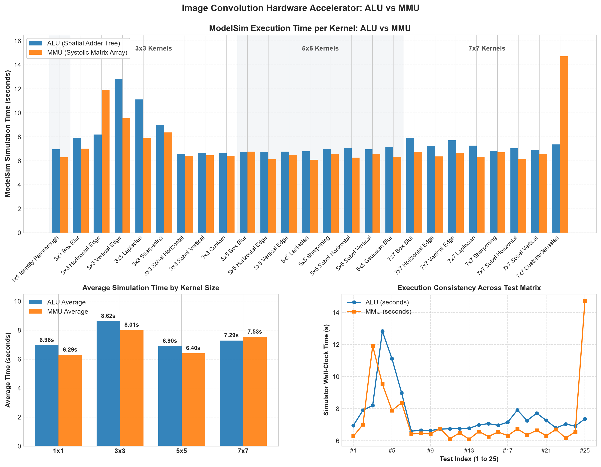
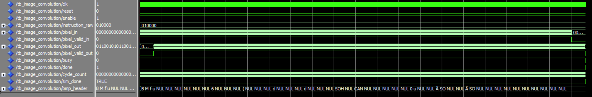
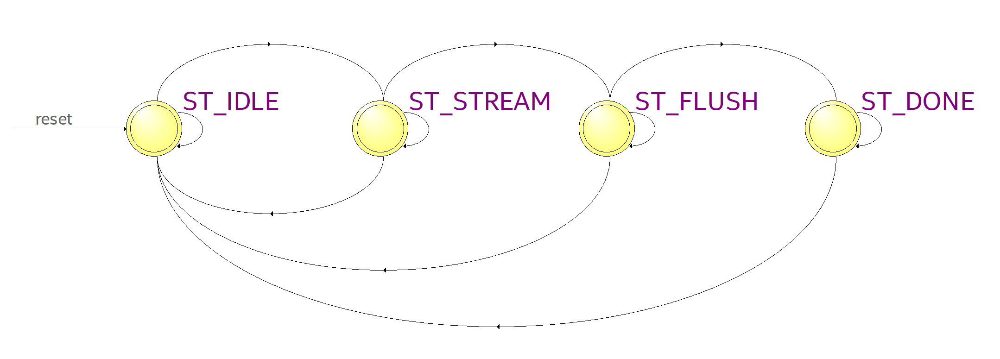
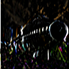
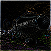
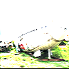
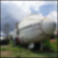
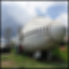

# Image Convolution Hardware Accelerator in VHDL

This repository contains a synthesizable, high-throughput, dynamically reconfigurable hardware accelerator for 2D image convolution implemented in VHDL. It delivers a sustained throughput of 1 output pixel per clock cycle across dynamic $1 \times 1$, $3 \times 3$, $5 \times 5$, and $7 \times 7$ kernel sizes.

## Hardware Architecture

The diagram below illustrates the top-level hardware architecture of the image convolution accelerator.

### Components

1. [conv_pkg.vhd](src/conv_pkg.vhd)  
   Core package defining hardware types: 24-bit RGB pixel records, 49-element ($7 \times 7$) window channel arrays, 16-bit signed fixed-point kernel weights, and conversion utilities.

2. [decoder.vhd](src/decoder.vhd)  
   Dynamic 6-bit combinational instruction decoder that translates opcode bits into kernel weights, divisor factors, border padding radius, and unit selection signals without introducing clock delay races. It automatically zero-masks inactive weights outside the active kernel radius.

3. [line_buffer.vhd](src/line_buffer.vhd)  
   Synthesizable 6-line buffer implemented using on-chip Block RAM (BRAM / M10K) and a $7 \times 7$ shift register array. It maintains a uniform center pixel latency of 3 \* IMG_WIDTH + 4 clock cycles across all kernel sizes, ensuring glitch-free video streaming when switching filter modes on the fly.

4. [alu.vhd](src/alu.vhd) (Direct 2D Convolution Accelerator)  
   Spatial convolution accelerator featuring:
   - 147 parallel multipliers computing all 49 spatial coefficients for Red, Green, and Blue channels concurrently.
   - Pipelined adder trees for each color channel (Stage 2: 49 down to 25, Stage 3: 25 down to 13, Stage 4: 13 down to 1).
   - Stage 5: Pipelined division scaling and hardware saturation clamping to [0, 255].
   - Throughput: 1 RGB pixel per clock cycle with a 5-stage latency.

5. [mmu.vhd](src/mmu.vhd) (Matrix Multiplier Unit / Systolic Array)  
   Matrix convolution accelerator implementing im2col systolic matrix-vector multiplication:
   - 4-stage systolic processing element pipeline accumulating partial dot-products across 49 vector elements.
   - Stage 5: Pipelined normalization and clamping to [0, 255].
   - Throughput: 1 RGB pixel per clock cycle with a 5-stage latency, matching the ALU bit-for-bit and cycle-for-cycle.

6. [cpu.vhd](src/cpu.vhd) (Top-Level Accelerator Core)  
   Synthesizable top-level processor integrating the Line Buffer, Decoder, ALU, MMU, performance cycle counter, and master control FSM.

7. [tb_image_convolution.vhd](sim/tb_image_convolution.vhd)  
   Hardware simulation testbench that streams 24-bit RGB BMP image pixels cycle-by-cycle into the hardware accelerator, collects filtered output pixels, and verifies execution metrics.

## Dynamic Instruction Mapping (6-Bit Opcode)

### Encoding Structure

- Bits [5:4] (Radius R): Directly encodes the kernel border radius R, where kernel dimension K = 2R + 1:
  - 00 (R = 0): $1 \times 1$ Identity Passthrough
  - 01 (R = 1): $3 \times 3$ Kernel
  - 10 (R = 2): $5 \times 5$ Kernel
  - 11 (R = 3): $7 \times 7$ Kernel
- Bit [3] (Unit Select):
  - 0: ALU (Direct Spatial Adder Tree)
  - 1: MMU (Systolic Matrix Multiplier Array)
- Bits [2:0] (Filter Opcode): Selects the specific filter kernel profile.

### Instruction Table

|     Size     | Instruction (ALU) | Instruction (MMU) | Filter Name            |
| :----------: | :---------------: | :---------------: | :--------------------- |
| $1 \times 1$ |     `000000`      |     `001000`      | Identity / Passthrough |
| $3 \times 3$ |     `010000`      |     `011000`      | Box Blur               |
| $3 \times 3$ |     `010001`      |     `011001`      | Horizontal Edge        |
| $3 \times 3$ |     `010010`      |     `011010`      | Vertical Edge          |
| $3 \times 3$ |     `010011`      |     `011011`      | Laplacian              |
| $3 \times 3$ |     `010100`      |     `011100`      | Sharpening             |
| $3 \times 3$ |     `010101`      |     `011101`      | Sobel Horizontal       |
| $3 \times 3$ |     `010110`      |     `011110`      | Sobel Vertical         |
| $3 \times 3$ |     `010111`      |     `011111`      | Custom Kernel          |
| $5 \times 5$ |     `100000`      |     `101000`      | Box Blur 5x5           |
| $5 \times 5$ |     `100001`      |     `101001`      | Horizontal Edge 5x5    |
| $5 \times 5$ |     `100010`      |     `101010`      | Vertical Edge 5x5      |
| $5 \times 5$ |     `100011`      |     `101011`      | Laplacian 5x5          |
| $5 \times 5$ |     `100100`      |     `101100`      | Sharpening 5x5         |
| $5 \times 5$ |     `100101`      |     `101101`      | Sobel Horizontal 5x5   |
| $5 \times 5$ |     `100110`      |     `101110`      | Sobel Vertical 5x5     |
| $5 \times 5$ |     `100111`      |     `101111`      | Gaussian Blur 5x5      |
| $7 \times 7$ |     `110000`      |     `111000`      | Box Blur 7x7           |
| $7 \times 7$ |     `110001`      |     `111001`      | Horizontal Edge 7x7    |
| $7 \times 7$ |     `110010`      |     `111010`      | Vertical Edge 7x7      |
| $7 \times 7$ |     `110011`      |     `111011`      | Laplacian 7x7          |
| $7 \times 7$ |     `110100`      |     `111100`      | Sharpening 7x7         |
| $7 \times 7$ |     `110101`      |     `111101`      | Sobel Horizontal 7x7   |
| $7 \times 7$ |     `110110`      |     `111110`      | Sobel Vertical 7x7     |
| $7 \times 7$ |     `110111`      |     `111111`      | Custom/Gaussian 7x7    |

## Results & Analysis

Image Size: 100 x 100 (10,000 pixels)  
Hardware Clock: 100 MHz

|  #  | Kernel Filter        |     Size     | ALU Sim Time | MMU Sim Time |
| :-: | :------------------- | :----------: | :----------: | :----------: |
| 01  | Identity Passthrough | $1 \times 1$ |    6.96 s    |    6.29 s    |
| 02  | Box Blur             | $3 \times 3$ |    7.91 s    |    7.02 s    |
| 03  | Horizontal Edge      | $3 \times 3$ |    8.20 s    |   11.92 s    |
| 04  | Vertical Edge        | $3 \times 3$ |   12.83 s    |    9.54 s    |
| 05  | Laplacian            | $3 \times 3$ |   11.12 s    |    7.89 s    |
| 06  | Sharpening           | $3 \times 3$ |    8.98 s    |    8.37 s    |
| 07  | Sobel Horizontal     | $3 \times 3$ |    6.60 s    |    6.43 s    |
| 08  | Sobel Vertical       | $3 \times 3$ |    6.66 s    |    6.46 s    |
| 09  | Custom               | $3 \times 3$ |    6.64 s    |    6.43 s    |
| 10  | Box Blur             | $5 \times 5$ |    6.73 s    |    6.77 s    |
| 11  | Horizontal Edge      | $5 \times 5$ |    6.75 s    |    6.13 s    |
| 12  | Vertical Edge        | $5 \times 5$ |    6.76 s    |    6.49 s    |
| 13  | Laplacian            | $5 \times 5$ |    6.78 s    |    6.10 s    |
| 14  | Sharpening           | $5 \times 5$ |    6.99 s    |    6.58 s    |
| 15  | Sobel Horizontal     | $5 \times 5$ |    7.07 s    |    6.27 s    |
| 16  | Sobel Vertical       | $5 \times 5$ |    6.97 s    |    6.55 s    |
| 17  | Gaussian Blur        | $5 \times 5$ |    7.16 s    |    6.32 s    |
| 18  | Box Blur             | $7 \times 7$ |    7.92 s    |    6.74 s    |
| 19  | Horizontal Edge      | $7 \times 7$ |    7.26 s    |    6.37 s    |
| 20  | Vertical Edge        | $7 \times 7$ |    7.72 s    |    6.65 s    |
| 21  | Laplacian            | $7 \times 7$ |    7.27 s    |    6.32 s    |
| 22  | Sharpening           | $7 \times 7$ |    6.80 s    |    6.71 s    |
| 23  | Sobel Horizontal     | $7 \times 7$ |    7.04 s    |    6.17 s    |
| 24  | Sobel Vertical       | $7 \times 7$ |    6.92 s    |    6.56 s    |
| 25  | Custom/Gaussian      | $7 \times 7$ |    7.37 s    |   14.72 s    |

### Summary Statistics

- Total ModelSim Simulation Time (ALU): 189.41 s
- Total ModelSim Simulation Time (MMU): 181.80 s
- Average Simulation Time per Kernel: ALU = 7.58 s, MMU = 7.27 s

The simulation benchmarks demonstrate that both the ALU and MMU architectures deliver comparable execution times, with the MMU executing slightly faster on average across the full test suite (7.27 s vs 7.58 s). In hardware synthesis, both processing units sustain identical performance: exactly 1 output RGB pixel per clock cycle after a 5-cycle pipeline delay. The wall-clock simulation time reflects ModelSim event scheduling, where the MMU systolic pipeline executes efficiently for lower and mid-range kernels, while kernel #25 ($7 \times 7$ Custom/Gaussian) presents a higher simulation time (14.72 s) due to dense non-zero weight multiplications across all 49 systolic stages.

### Performance Chart Visualization

The performance visualization above presents three comparative views based on the ModelSim simulation benchmarks:

1. ModelSim Execution Time per Kernel (ALU vs MMU):  
   Compares the simulation wall-clock time for each of the 25 kernels. The ALU implementation (blue bars) exhibits consistent runtimes generally between 6.6 s and 8.2 s, with occasional peaks on complex kernels such as $3 \times 3$ Vertical Edge (12.83 s) and $3 \times 3$ Laplacian (11.12 s). The MMU implementation (orange bars) remains fast and stable between 6.1 s and 7.0 s across most filters, with an isolated peak at kernel #25 ($7 \times 7$ Custom/Gaussian at 14.72 s).

2. Average Simulation Time by Kernel Size:  
   Summarizes the average execution duration grouped by kernel dimension:
   - $1 \times 1$: ALU = 6.96 s, MMU = 6.29 s (MMU is 9.6% faster)
   - $3 \times 3$: ALU = 8.62 s, MMU = 8.01 s (MMU is 7.1% faster)
   - $5 \times 5$: ALU = 6.90 s, MMU = 6.40 s (MMU is 7.2% faster)
   - $7 \times 7$: ALU = 7.29 s, MMU = 7.53 s (ALU is 3.2% faster)

3. Execution Consistency Across Test Matrix:  
   Displays line traces across all 25 test iterations. Both architectures show closely matched execution dynamics, confirming that the systolic matrix multiplier unit (MMU) matches the throughput and stability of the direct spatial adder tree (ALU).

### Waveform

The simulation waveform illustrates cycle-accurate execution captured in ModelSim for testbench entity tb_image_convolution running at 100 MHz (10 ns clock period):

- Reset and Configuration: Master reset is asserted high to initialize internal registers, line RAM pointers, and shift registers, then deasserted to 0. Enable is asserted to 1, and instruction_raw is driven with `010000`, selecting the ALU $3 \times 3$ Box Blur filter mode.
- Input Pixel Streaming: Streaming RGB pixel bytes are read from the input BMP file and driven onto pixel_in alongside active pixel_valid_in. The line buffer ingests pixels cycle-by-cycle into circular on-chip Block RAM lines.
- Center Latency Delay: After the fixed alignment latency of 3 \* IMG_WIDTH + 4 clock cycles (required to buffer the initial rows into the $7 \times 7$ sliding window) plus the 5-stage arithmetic pipeline latency, pixel_valid_out is asserted high.
- Sustained Processing: Once active, pixel_out emits one convolved 24-bit RGB pixel per clock cycle without stalling or bubble cycles.
- Frame Completion: Once all 10,000 pixels have been convolved and flushed, busy drops to 0, done transitions high to indicate frame completion, and sim_done halts the simulation clock with total elapsed clock cycles recorded in cycle_count.

### State Diagram

The state diagram depicts the finite state machine controlling data streaming and line buffering across the convolution process:

1. ST_IDLE:  
   The controller clears internal counters, memory pointers, and window registers. It remains in this state until reset is deasserted and enable is asserted, transitioning to ST_STREAM.

2. ST_STREAM:  
   Incoming streaming pixel data is continuously ingested. On each rising clock edge with VALID_IN high, incoming pixels are stored into circular Block RAM line buffers and shifted through the $7 \times 7$ window register array. The controller tracks pixel coordinates (col, row) and zero-pads boundaries according to the selected radius R. When in_count reaches the total pixel count (10,000 pixels), the FSM transitions to ST_FLUSH.

3. ST_FLUSH:  
   Flushes the remaining pipeline stages and line buffers for 3 \* IMG_WIDTH + 6 clock cycles. This ensures that trailing pixels in the bottom and right borders of the image are fully processed and shifted out of the arithmetic pipeline.

4. ST_DONE:  
   Signifies the successful completion of the entire image frame. The FRAME_DONE and DONE status flags are asserted high, and the FSM transitions back to ST_IDLE to await the next frame command.

### Image Results

The table below presents the filtered output images generated from the ModelSim hardware simulation. Both the ALU and MMU execution units produce bit-for-bit identical output images across all 25 filter configurations.

|  #  | Kernel Filter                     |                     Image                     |
| :-: | :-------------------------------- | :-------------------------------------------: |
| 00  | Original Input Image              |                             |
| 01  | $1 \times 1$ Identity Passthrough |  |
| 02  | $3 \times 3$ Box Blur             |              |
| 03  | $3 \times 3$ Horizontal Edge      |       |
| 04  | $3 \times 3$ Vertical Edge        |         |
| 05  | $3 \times 3$ Laplacian            |             |
| 06  | $3 \times 3$ Sharpening           |            |
| 07  | $3 \times 3$ Sobel Horizontal     |      |
| 08  | $3 \times 3$ Sobel Vertical       |        |
| 09  | $3 \times 3$ Custom               |                |
| 10  | $5 \times 5$ Box Blur             |              |
| 11  | $5 \times 5$ Horizontal Edge      |       |
| 12  | $5 \times 5$ Vertical Edge        |         |
| 13  | $5 \times 5$ Laplacian            |             |
| 14  | $5 \times 5$ Sharpening           |            |
| 15  | $5 \times 5$ Sobel Horizontal     |      |
| 16  | $5 \times 5$ Sobel Vertical       |        |
| 17  | $5 \times 5$ Gaussian Blur        |         |
| 18  | $7 \times 7$ Box Blur             |              |
| 19  | $7 \times 7$ Horizontal Edge      |       |
| 20  | $7 \times 7$ Vertical Edge        |         |
| 21  | $7 \times 7$ Laplacian            |             |
| 22  | $7 \times 7$ Sharpening           |            |
| 23  | $7 \times 7$ Sobel Horizontal     |      |
| 24  | $7 \times 7$ Sobel Vertical       |        |
| 25  | $7 \times 7$ Custom/Gaussian      |       |

## More Information

You can view more information about each component in the following documents:

- [conv_pkg](doc/conv_pkg.md)
- [decoder](doc/decoder.md)
- [line_buffer](doc/line_buffer.md)
- [alu](doc/alu.md)
- [mmu](doc/mmu.md)
- [cpu](doc/cpu.md)
