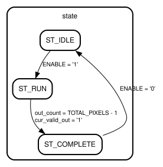

# Entity: CPU 
- **File**: cpu.vhd
- **Brief:**  Top-Level Synthesizable Image Convolution Hardware Accelerator (CPU)
- **Details:**  Top-level processor integrating the 6-bit instruction decoder, 6-line BRAM buffer with 7x7 window generator, 49-multiplier direct spatial ALU, 49-PE systolic MMU, and master execution FSM with hardware cycle counter.

## Diagram

## Description

## Generics

| Generic name | Type    | Value | Description            |
| ------------ | ------- | ----- | ---------------------- |
| IMG_WIDTH    | INTEGER | 100   | Image width in pixels  |
| IMG_HEIGHT   | INTEGER | 100   | Image height in pixels |

## Ports

| Port name       | Direction | Type                          | Description                                    |
| --------------- | --------- | ----------------------------- | ---------------------------------------------- |
| CLK             | in        | STD_LOGIC                     | Primary system clock input                     |
| RESET           | in        | STD_LOGIC                     | Synchronous active-high master reset           |
| ENABLE          | in        | STD_LOGIC                     | Accelerator run enable control                 |
| INSTRUCTION_RAW | in        | STD_LOGIC_VECTOR(5 DOWNTO 0)  | 6-bit packed filter configuration instruction  |
| PIXEL_IN        | in        | STD_LOGIC_VECTOR(23 DOWNTO 0) | 24-bit input streaming RGB pixel               |
| PIXEL_VALID_IN  | in        | STD_LOGIC                     | Strobe indicating input pixel is valid         |
| PIXEL_OUT       | out       | STD_LOGIC_VECTOR(23 DOWNTO 0) | 24-bit convolved output RGB pixel              |
| PIXEL_VALID_OUT | out       | STD_LOGIC                     | Strobe indicating output pixel is valid        |
| BUSY            | out       | STD_LOGIC                     | High during image frame convolution processing |
| DONE            | out       | STD_LOGIC                     | High when complete frame has been convolved    |
| CYCLE_COUNT     | out       | UNSIGNED(31 DOWNTO 0)         | Hardware performance execution cycle counter   |

## Signals

| Name          | Type                            | Description                                               |
| ------------- | ------------------------------- | --------------------------------------------------------- |
| state         | state_t                         | Current state of the top-level convolution controller     |
| opcode        | STD_LOGIC_VECTOR(2 DOWNTO 0)    | Decoded 3-bit filter opcode                               |
| radius        | INTEGER RANGE 0 TO 3            | Decoded kernel border radius (0=1x1, 1=3x3, 2=5x5, 3=7x7) |
| unit_select   | STD_LOGIC                       | Decoded execution unit selector ('0' = ALU, '1' = MMU)    |
| weights       | kernel_weights_t                | Decoded 49-element kernel weights array                   |
| divisor       | INTEGER RANGE 1 TO 256          | Decoded normalization divisor factor                      |
| window_r      | window_channel_t                | Red channel 7x7 sliding window vector from line buffer    |
| window_g      | window_channel_t                | Green channel 7x7 sliding window vector from line buffer  |
| window_b      | window_channel_t                | Blue channel 7x7 sliding window vector from line buffer   |
| window_valid  | STD_LOGIC                       | Strobe indicating sliding window data is valid            |
| lb_frame_done | STD_LOGIC                       | Frame completion strobe from line buffer                  |
| lb_busy       | STD_LOGIC                       | Busy status flag from line buffer                         |
| enable_alu    | STD_LOGIC                       | ALU execution enable signal                               |
| alu_pixel_out | STD_LOGIC_VECTOR(23 DOWNTO 0)   | 24-bit convolved RGB pixel output from ALU                |
| alu_valid_out | STD_LOGIC                       | Output pixel valid strobe from ALU                        |
| enable_mmu    | STD_LOGIC                       | MMU execution enable signal                               |
| mmu_pixel_out | STD_LOGIC_VECTOR(23 DOWNTO 0)   | 24-bit convolved RGB pixel output from MMU                |
| mmu_valid_out | STD_LOGIC                       | Output pixel valid strobe from MMU                        |
| cycle_cnt     | UNSIGNED(31 DOWNTO 0)           | Internal 32-bit execution cycle counter                   |
| out_count     | INTEGER RANGE 0 TO TOTAL_PIXELS | Processed output pixel count tracker                      |

## Constants

| Name         | Type    | Value                  | Description                       |
| ------------ | ------- | ---------------------- | --------------------------------- |
| TOTAL_PIXELS | INTEGER | IMG_WIDTH * IMG_HEIGHT | Total pixel count per image frame |

## Enums

### *state_t*
 Top-level controller finite state machine states

| Name        | Description |
| ----------- | ----------- |
| ST_IDLE     |             |
| ST_RUN      |             |
| ST_COMPLETE |             |

## Processes
- fsm_cycle_proc: ( CLK )
  - **Description**
  Master control FSM and performance cycle counter process

## Instantiations

- U_DECODER: DECODER
- U_LINE_BUFFER: LINE_BUFFER
- U_ALU: ALU
- U_MMU: MMU

## State machines

- Master control FSM and performance cycle counter process
