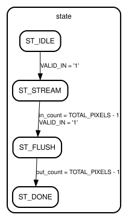

# Entity: LINE_BUFFER

- **File:** line_buffer.vhd
- **Brief:** Dynamic Multi-Scale Line Buffer & Window Generator
- **Details:** Manages 6 on-chip Block RAM circular line buffers and a 7x7 sliding window register array with boundary zero-padding for radius R=0..3.

## Diagram

## Generics

| Generic name | Type    | Value | Description                              |
| ------------ | ------- | ----- | ---------------------------------------- |
| IMG_WIDTH    | INTEGER | 1000  | Maximum supported image width in pixels  |
| IMG_HEIGHT   | INTEGER | 1000  | Maximum supported image height in pixels |

## Ports

| Port name    | Direction | Type                          | Description                                       |
| ------------ | --------- | ----------------------------- | ------------------------------------------------- |
| CLK          | in        | STD_LOGIC                     | Primary system clock input                        |
| RST          | in        | STD_LOGIC                     | Synchronous active-high reset signal              |
| RADIUS       | in        | INTEGER RANGE 0 TO 3          | Kernel border radius (0=1x1, 1=3x3, 2=5x5, 3=7x7) |
| VALID_IN     | in        | STD_LOGIC                     | Strobe indicating input pixel is valid            |
| PIXEL_IN     | in        | STD_LOGIC_VECTOR(23 DOWNTO 0) | 24-bit input streaming RGB pixel                  |
| WINDOW_R     | out       | window_channel_t              | 49-element red channel spatial sliding window     |
| WINDOW_G     | out       | window_channel_t              | 49-element green channel spatial sliding window   |
| WINDOW_B     | out       | window_channel_t              | 49-element blue channel spatial sliding window    |
| WINDOW_VALID | out       | STD_LOGIC                     | Strobe indicating current window pixels are valid |
| FRAME_DONE   | out       | STD_LOGIC                     | Strobe indicating frame processing completion     |
| BUSY         | out       | STD_LOGIC                     | High while streaming pixels or flushing pipeline  |

## Signals

| Name        | Type                                           | Description                                                          |
| ----------- | ---------------------------------------------- | -------------------------------------------------------------------- |
| line_ram_0  | line_ram_t                                     | Line RAM 0 storing the most recent buffered image row                |
| line_ram_1  | line_ram_t                                     | Line RAM 1 storing the second buffered image row                     |
| line_ram_2  | line_ram_t                                     | Line RAM 2 storing the third buffered image row                      |
| line_ram_3  | line_ram_t                                     | Line RAM 3 storing the fourth buffered image row                     |
| line_ram_4  | line_ram_t                                     | Line RAM 4 storing the fifth buffered image row                      |
| line_ram_5  | line_ram_t                                     | Line RAM 5 storing the sixth buffered image row                      |
| ram_ptr     | INTEGER RANGE 0 TO IMG_WIDTH - 1               | Circular memory address pointer within the line buffers              |
| in_count    | INTEGER RANGE 0 TO TOTAL_PIXELS + FLUSH_CYCLES | Total input pixel counter tracking pixels received                   |
| flush_count | INTEGER RANGE 0 TO FLUSH_CYCLES                | Counter tracking pipeline flush cycles after frame end               |
| out_count   | INTEGER RANGE 0 TO TOTAL_PIXELS                | Total convolved output pixel counter                                 |
| out_col     | INTEGER RANGE 0 TO IMG_WIDTH - 1               | Output image column coordinate tracker (0 to IMG_WIDTH - 1)          |
| out_row     | INTEGER RANGE 0 TO IMG_HEIGHT - 1              | Output image row coordinate tracker (0 to IMG_HEIGHT - 1)            |
| state       | state_t                                        | Current state of the line buffer controller state machine            |
| win_reg     | win_reg_t                                      | 7x7 spatial window register array holding active neighborhood pixels |

## Constants

| Name           | Type    | Value                   | Description                                                |
| -------------- | ------- | ----------------------- | ---------------------------------------------------------- |
| TOTAL_PIXELS   | INTEGER | IMG_WIDTH \* IMG_HEIGHT | Total pixel count per image frame                          |
| CENTER_LATENCY | INTEGER | 3 \* IMG_WIDTH + 4      | Latency cycles until center pixel is aligned in 7x7 window |
| FLUSH_CYCLES   | INTEGER | 3 \* IMG_WIDTH + 6      | Post-frame pipeline flush cycles                           |

## Types

| Name       | Description                                                        |
| ---------- | ------------------------------------------------------------------ |
| line_ram_t | Single-line BRAM circular memory buffer type holding one image row |
| win_reg_t  | 7x7 spatial 2D sliding window shift register matrix                |

## Enums

### _state_t_

Line buffer controller finite state machine states

| Name      | Description                               |
| --------- | ----------------------------------------- |
| ST_IDLE   | Line buffer is idle and waiting for input |
| ST_STREAM | Line buffer is streaming input data       |
| ST_FLUSH  | Line buffer is flushing remaining data    |
| ST_DONE   | Line buffer has completed its operation   |

## Processes

- line_buffer_fsm_proc
  - This process has a sensitivity list of CLK
  - This process implements the line buffer controller finite state machine, managing the streaming of input pixels, the shifting of the 7x7 sliding window, and the flushing of remaining pipeline data after the end of the image frame

> For smaller kernels, the sliding window will contain zero-padded pixels at the borders, ensuring that the convolution operation can be applied consistently across the entire image, including the edges. Flushing is done by pumping additional zero-valued pixels into the line buffer after the last valid input pixel has been received, allowing the pipeline to complete processing of all valid pixels in the frame.

## State machines

